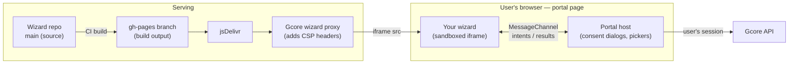
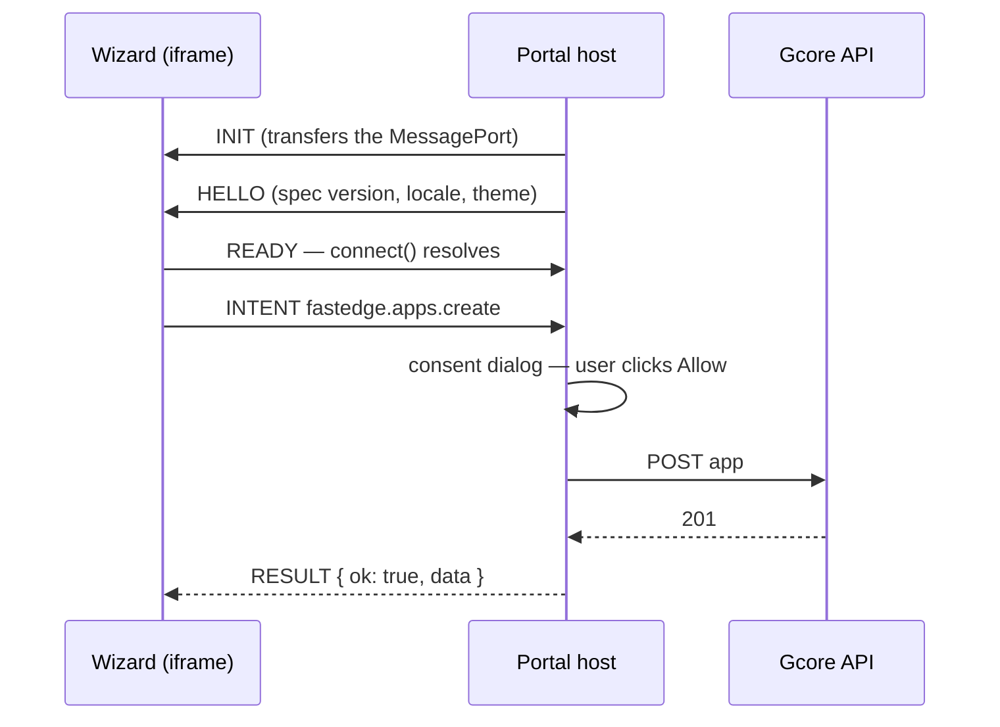

# Wizard runtime rules

The SDK's types tell you what you can call. This page covers the runtime behaviour the types
can't show: the browser sandbox your wizard runs in, which resources it is allowed to touch, and
what happens to a deployment that fails. Each rule here fails silently or with an unhelpful error
if you don't know about it.

## How a wizard is served and connected



- The portal never frames GitHub or jsDelivr directly. A Gcore proxy fetches your built files and
  re-serves them from one fixed origin with a strict Content-Security-Policy.
- Your wizard never holds a credential. It sends **intents** over a `MessageChannel`; the portal
  validates each one, asks the user to consent to writes, and makes the API call itself.



## The sandbox

The iframe has `sandbox="allow-scripts"` and nothing else, and the proxy sends
`Content-Security-Policy: default-src 'self'; connect-src 'none'`. In practice:

| You can't                                                      | Because                                 | Do this instead                                                        |
| -------------------------------------------------------------- | --------------------------------------- | ---------------------------------------------------------------------- |
| `fetch`, `XMLHttpRequest`, WebSocket, `EventSource`            | `connect-src 'none'`                    | Get all data through the SDK                                           |
| Load scripts, styles, fonts or images from another origin      | `default-src 'self'`                    | Bundle everything; reference assets relatively (`./logo.svg`)          |
| Use `data:` or `blob:` URLs for images or fonts                | `default-src 'self'` (neither is `'self'`) | Ship the file and reference it by relative path, or use inline `<svg>` |
| Inline `<script>`, inline `<style>`, `style="…"` attributes     | `default-src 'self'` (no `unsafe-inline`) | External `./main.js` / `./styles.css` files and CSS classes            |
| Use `localStorage`, `sessionStorage`, IndexedDB or cookies     | Opaque origin (no `allow-same-origin`)  | Keep state in memory; persist through app `env` via the SDK if it must survive |
| `alert`, `confirm`, `prompt`                                   | No `allow-modals`                       | Render your own in-page UI                                             |
| `window.open`, `target="_blank"` links                         | No `allow-popups`                       | Show the URL as text the user can copy                                 |
| Submit a `<form>`                                              | No `allow-forms` — `submit` never fires | Handle the button's `click` event (see `wizards/_template/`)           |
| Navigate the frame after `connect()` resolves                  | The portal treats it as a hijack        | Stay a single page; switch steps in the DOM                            |

Navigating the frame after the handshake makes the portal tear the wizard down with
`protocol_error`. This includes `location.href = …` and full-page reloads.

### Images, icons, logos and fonts

Ship them with the wizard. Files in your wizard's build output are served from the same origin
as the wizard, so they load like any other asset:

- **Files**, referenced by relative path: ``,
  `background-image: url(./assets/bg.png)`, or `@font-face { src: url(./fonts/brand.woff2) }`.
- **Inline `<svg>`** in your HTML or JSX. It is part of the page, not a separate download, so
  the CSP doesn't restrict it.

Remote URLs (`https://cdn.example.com/logo.png`), `data:` URIs and `blob:` URLs are blocked.
Check your bundler too: esbuild's `dataurl` loader, and similar asset-inlining in other bundlers,
turns an imported image into a `data:` URI that the browser refuses to load. Use esbuild's `file`
loader, or copy the assets into the output folder, instead.

Draw icons with `fill="currentColor"` (or `stroke="currentColor"`) so they follow the
`--gc-wizard-*` colour tokens, including dark mode.

You don't need to add a product logo or header: the portal around the wizard already shows one.

## What your wizard can touch: the managed set

The portal tracks the resources each wizard **owns**. A wizard can read or modify only those.
Anything else fails with `WizardError` code `out_of_scope`.

| A resource joins the managed set when…                                    | Gated intents                                                   |
| ------------------------------------------------------------------------- | --------------------------------------------------------------- |
| You create an app (`apps.create`, or `deployment.apply`)                  | `apps.get`, `apps.update`, `apps.link`, `cdn.origins.create`'s `appId`, rule `fastedgeFilter.appId` |
| The user picks or creates a secret (`secrets.pickOrCreate`, `secrets.generateKeypair`) | Every `secretRefs` value you pass                     |
| The user picks or creates a store (`stores.pickOrCreate`)                 | Every store reference you pass                                  |
| The user picks a CDN resource (`cdn.resources.pick`)                      | `cdn.rules.create`'s `resourceId`, `deployment.plan`'s `cdnResourceId` |
| You create an origin group (`cdn.origins.create`, or `deployment.apply`)  | `cdn.rules.create`'s `originGroupId`                            |

So: **pick first, then use.** For example, call `cdn.resources.pick()` before passing that
resource's id to `cdn.rules.create` or `deployment.plan`. `cdn.resources.list()` shows the
account's resources, but listing one does not make it yours.

The list intents are not all scoped the same way. `fastedge.apps.list` returns only managed apps.
`cdn.resources.list`, `cdn.origins.list` and `fastedge.templates.list` return account-wide data.

## Template mode and re-entry

A wizard is launched in one of two ways. Check `context.get()` to tell them apart:

| Launch                                       | `launchTemplateId` | `wizardAppId`        | Managed set at start                     |
| -------------------------------------------- | ------------------ | -------------------- | ---------------------------------------- |
| From a template (first run)                  | the template id    | `null`               | empty                                    |
| From an app the wizard deployed (re-entry)   | `null`             | the wizard's anchor app | everything recorded by earlier runs   |

The **first app your wizard creates becomes its anchor**. The portal records every resource the
wizard owns in that app's environment, so a later re-entry starts with the same managed set and
can `apps.get` / `apps.update` what it deployed before. Before the first app exists, the managed
set lives only in memory: if the user closes the page, it is lost.

## Reserved environment keys

Env keys starting with `WIZARD_` belong to the portal (it uses them for the anchor record above).
They are **silently removed** from any `env` or `sharedEnv` you send through `apps.create`,
`apps.update`, `apps.link` or `deployment.plan`. The rest of the patch still applies, and no error
is raised. Don't name your own variables `WIZARD_*`.

## Consent and timing

- Every write opens a portal consent dialog. Pickers (`secrets.pickOrCreate`,
  `stores.pickOrCreate`, `secrets.generateKeypair`, `cdn.resources.pick`) count as consent.
  If the user dismisses either kind, the call fails with `user_cancelled`.
- The host's 60 s execution timeout starts **after** the user consents. The SDK also enforces a
  90 s timeout from when the call is made, including time spent waiting for consent, so leaving
  a dialog open can still cause the call to reject with `timeout`.
- `apps.update` and `apps.link` **shallow-merge** `env` and `secretRefs`: keys you omit are kept.

## Deployments: plan, apply and rollback

Prefer `session.deployment.deploy()`, which plans, applies and streams progress for you.

- `plan` makes no writes. It validates the request and returns a `planId` and a summary.
- `apply` shows the summary in one consent dialog. A plan can be applied **once**; applying it
  again fails with `not_found`. If the user cancels, the plan is kept and you can retry.
- If a step fails, the portal **rolls back** what that apply created: apps, origin groups and
  rules. It also restores any CDN resource settings it changed. The call **resolves** (doesn't
  reject) with `status: 'rolled_back'`, or `'partial'` if the rollback itself partly failed;
  `failedStep` says what went wrong. Rolled-back ids leave the managed set.
- Secrets and stores are **not** created by a plan. Create them first with the pickers and
  reference their ids. After a rollback, picked or created secrets and stores are kept; run the
  picker again to reattach them. Keypair secrets are the exception: they are deleted with the apps,
  because their public half lived in an app that no longer exists.
- `cdnResourceFastedgeHandlers` merges into the resource's existing handlers. If a hook you
  request is already attached to an app your wizard doesn't own, apply fails with `conflict`
  rather than taking it over.

## Theme, locale and branding

The SDK applies the portal's theme (light or dark) automatically, including when the user
switches it mid-session. It also sets `<html lang>` to the portal locale. Translating your own
text is up to you; read `locale` from `context.get()`.
Style with the `--gc-wizard-*` tokens from the shared stylesheet so both themes work.

On a white-label portal (a reseller that rebrands the portal), the portal also sends the
reseller's brand colour, and the SDK sets it as `--gc-wizard-brand` for you. Use
`var(--gc-wizard-brand)` for accents and your wizard follows each reseller's brand. Only the brand
colour changes: text, surface and button tokens stay the same on every portal, as they do in
the portal's own components.

To preview a brand locally, put a `wizard-brand.json` in your repo root (or any folder above the
wizard). The mock host sends it the same way the portal does, to every wizard below it:

```json
{ "brand": "#ff7900", "brandDark": "#ff9a40" }
```

`brandDark` is optional; without it, `brand` is used in both themes. For a one-off check, pass
`--brand '#ff7900'` (and `--brand-dark`) to the dev command instead. Quote the value: an
unquoted `#` starts a shell comment.
